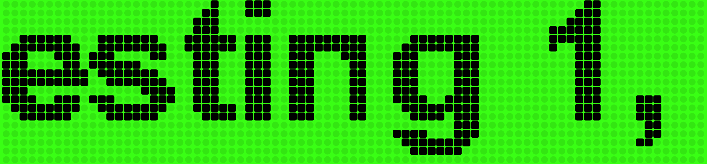

# Pocket Message Board

*By Astra.* A scrolling LED sign for any screen: a neon green dot board with big black letters you can read from the
street. Put it on an iPad in a shop window, a phone, or a computer screen.

## The Sign

**[▶ Open Pocket Message Board](https://findastra.github.io/pocket-message-board/)**

**Needs:** a browser on a phone, an iPad or a computer.

### Using it

| | |
| --- | --- |
| **Any screen, either way up** | The letters fill the screen. Turn a phone or iPad and the sign turns with it; drag a computer window to any shape and the sign fills it. On a phone with a notch, the letters stay clear of it. |
| **Full screen** | Tap (or click) the sign once to go full screen. Tap again to change the message, speed, letter size or colors, then tap **Show sign**. On a computer, **F** goes in and out of full screen. |
| **iPhone** | Safari has no full screen for pages, so add it to your Home Screen (Share, then **Add to Home Screen**) and open it from the new icon: it opens with no browser bars. That works on an iPad too. |
| **Keep the screen on** | The sign asks the device to stay awake while it shows, where the browser allows it. For a sign that stays up all day, also set the device's auto-lock to never (iPad: Settings → Display & Brightness → Auto-Lock → **Never**). |

The device remembers the last message, colors, speed and size you set (in that browser only).

## Quirks

1. Full screen needs a browser that allows it for a page (iPad Safari, Android Chrome, computers). iPhone Safari does
   not: use Add to Home Screen.
2. Whether the screen stays awake is the browser's call; auto-lock set to never is the sure way.
3. Settings are saved in the browser you set them in. Another device, or a cleared browser, starts from "Testing 1, 2,
   3".
4. The letters are drawn from the device's own bold font, so their exact shapes differ a little between an iPhone,
   Android and Windows.

## Developer Notes

1. **What's where:** `index.html` is the whole sign, with no build step; `manifest.webmanifest` and `icon-512.png` give
   the Home Screen app its name and icon.
2. **How it was checked:** with Platform Platypus's `fit-check` and `device-shots` tools (Mirror Pool,
   findastra/platform-platypus, a private repo): every phone, iPad and computer window in its device list, upright and
   on its side, loaded fresh and turned or resized live. A headless browser pretending to be a device is not the
   device: the last check is always the real phone or iPad.
3. **The old name:** it was called LED Message Board for its first day; the old link
   (findastra.github.io/led-message-board) sends you here.

## Credits

1. Built with Claude Opus 5.5, from 2026-10-19.
2. The picture above is a screenshot of the live sign, 2026-10-29.
